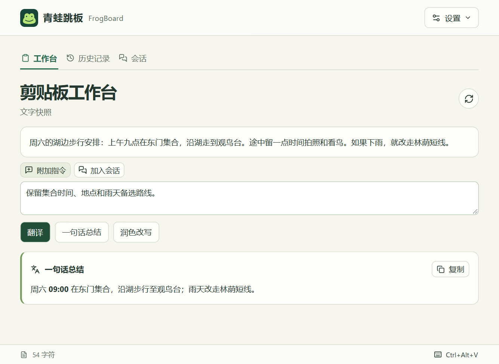
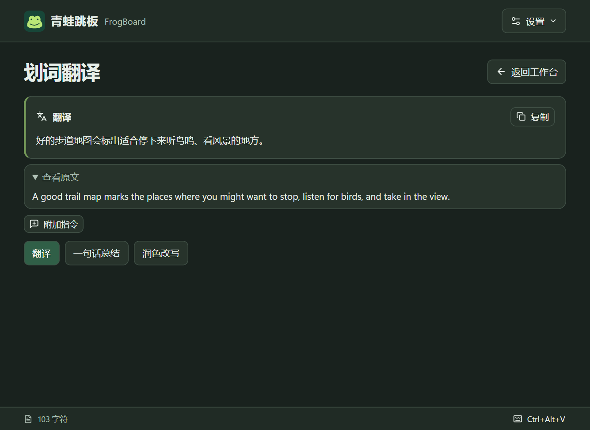
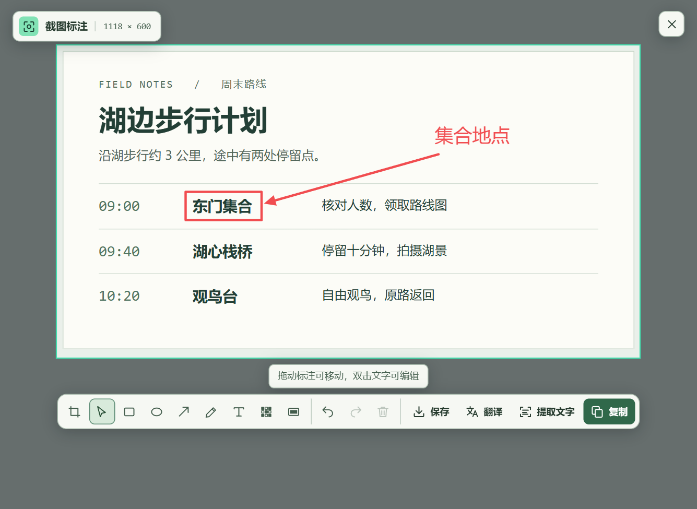
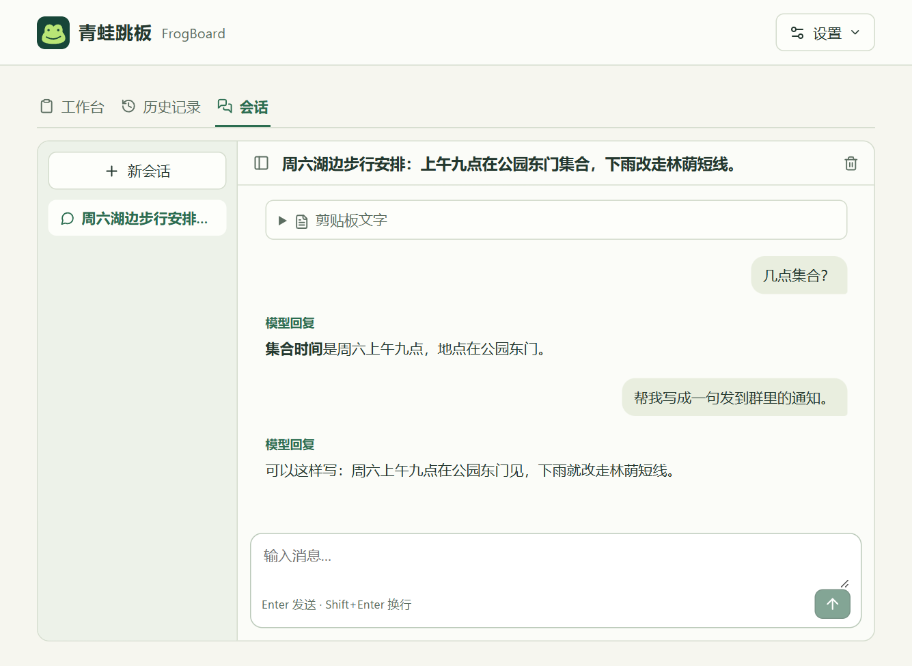

# 青蛙跳板 · FrogBoard

青蛙跳板是一款 Windows 桌面工具。读外文时，选中一句就能看译文；遇到图片或扫描件，框出要读的部分也能翻译。平时复制的文字和图片可以带到同一个工作台，继续总结、润色或标注。

**[下载 Windows x64 版](https://github.com/frogchou/frogboard/releases/latest)** · [设计文档](docs/design.md) · [迭代记录](docs/iterations.md)



## 第一次使用

1. 在发布页下载 `x64-setup.exe` 安装到当前用户，或下载 `x64-portable.exe` 直接运行。两种版本都使用 Windows 的 WebView2 运行时。
2. 复制一段文字，按 `Ctrl+Alt+V` 打开工作台。使用翻译或总结前，先到「设置 → 模型与动作」添加自己的模型，选为文字默认模型并保存。截图和标注可以直接使用。
3. 回到工作台点击「一句话总结」。如果有临时要求，先点「附加指令」，写下例如「保留集合时间和地点」，再执行操作。结果支持 Markdown 排版，也可一键复制。

| 想做的事 | 默认快捷键 | 使用方式 |
| --- | --- | --- |
| 处理已复制的内容 | `Ctrl+Alt+V` | 打开工作台，读取此刻的文字或图片。点击刷新可读取下一份内容。 |
| 翻译屏幕上的一段内容 | `Ctrl+Alt+T` | 在原应用中选中文字后按键。取不到文字时会进入框选截图翻译。 |
| 截图并标注 | `Ctrl+Alt+A` | 拖动框选区域，画完按回车复制，也可以保存为 PNG。 |

关闭窗口后，青蛙跳板会留在系统托盘。双击托盘图标可重新打开工作台，右击可截图或退出。快捷键可在「设置 → 快捷键与划词」修改，方便避开与微信等应用的冲突。

## 划词翻译

阅读时选中文字，通过划词按钮或快捷键打开译文。可以展开原文对照阅读，也可以在同一窗口接着润色、总结或返回工作台。



## 截图与标注

框选后可画矩形、椭圆、箭头和自由线条，也可添加文字、马赛克或实心遮挡。浏览器和聊天里已经复制的图片，在工作台点「继续标注」即可编辑。复制、保存、翻译和提取文字都会使用标注后的画面。



截图中的文字、图片和模型回复均为演示样例。

## 围绕剪贴板内容继续聊（0.1.9）

在工作台点「附加指令」旁的「加入会话」，当前文字或图片会带入新会话。你可以先问「几点集合？」，再追问「帮我写成一句发到群里的通知」。已填写的附加指令会带入输入框。按 Enter 发送，Shift+Enter 换行。

在「会话」标签可以新建空白对话、切换到之前的会话，或删除当前会话。会话保存在本机，重新打开软件后仍可继续。发送时会把本会话的原始材料和此前对话一起交给模型。



## 模型、操作与历史

- **模型连接**支持兼容 OpenAI Chat Completions 或 Responses 的服务。填写接口地址、模型 ID 和服务所需的 API 密钥。常见接口地址以 `/v1` 结尾，只有 Responses 接口的服务也可直接填到 `/v1/responses`。要识图或翻译截图，请为支持图片输入的模型启用图片能力，并将它设为默认视觉模型。
- **提示词操作**可按自己的工作方式调整。在「模型与动作 → 提示词操作」编辑现有提示词或新增操作，例如「把会议记录整理成三条待办」。工作台的附加指令仅针对本次执行。
- **历史记录**在本机保留最近 30 条已完成的操作。点一条记录可恢复当时的文字或图片、模型结果和附加指令，再选择另一项操作。可在「设置 → 通用设置」暂停记录，也可在那里切换浅色、深色、跟随系统或开启登录后驻留托盘。

截图、复制和保存可以离线使用。触发模型操作时，青蛙跳板会将本次输入和提示词发送到你配置的服务。API 密钥保存在 Windows 凭据管理器中。连接远程模型建议使用 HTTPS，HTTP 会明文传输请求内容和密钥。

## 本地开发

桌面端使用 Rust 和 Tauri 2，工作台与标注编辑器使用 React 和 TypeScript。在 Windows x64 上准备 Node.js 24、Rust stable MSVC、Visual Studio 2022 C++ 生成工具（含 Windows SDK）和 WebView2，然后运行：

```powershell
npm ci
npm run desktop
```

| 命令 | 用途 |
| --- | --- |
| `npm run dev` | 在浏览器预览前端，系统剪贴板、选区与托盘需要桌面版 |
| `npm test` | 测试截图选区、标注模型和 Markdown 结果渲染 |
| `npm run build` | 检查 TypeScript 并构建前端 |
| `cargo test --locked --manifest-path src-tauri/Cargo.toml` | 运行原生模块测试 |
| `npm run package` | 构建 Windows 可执行文件和当前用户安装包 |
| `.\scripts\windows-smoke.ps1` | 在交互式 Windows 桌面检查已打包程序的工作台、设置和截图入口 |

默认构建产物为 `src-tauri/target/release/frogboard.exe`，安装包位于 `src-tauri/target/release/bundle/nsis/`。首次构建可能需要下载 NSIS 与 WebView2 引导程序。

工作台和视图切换位于 `src/`，标注编辑器位于 `src/editor/`，模型设置与提示词位于 `src/models/`。Windows 选区、截图和剪贴板集成位于 `src-tauri/src/desktop/`。窗口交互、技术选择与已知限制详见[设计文档](docs/design.md)和[迭代记录](docs/iterations.md)。
